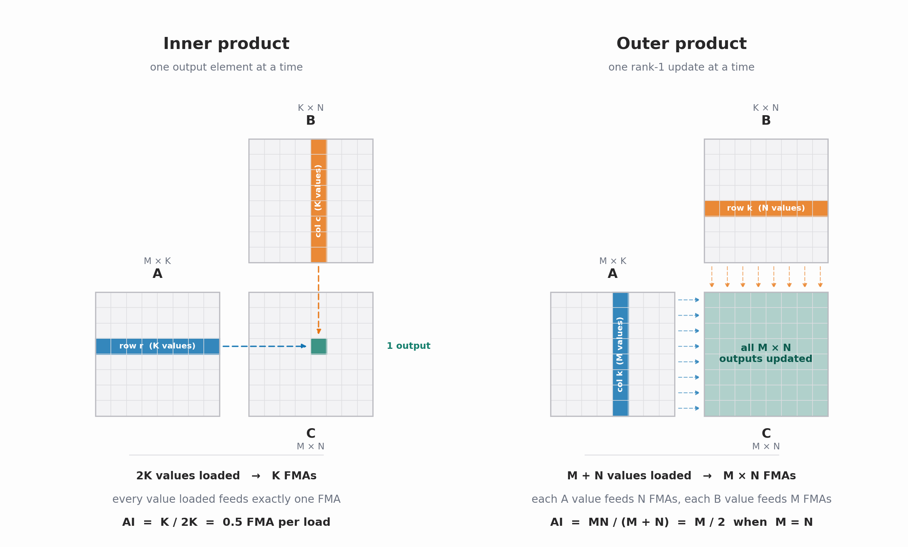
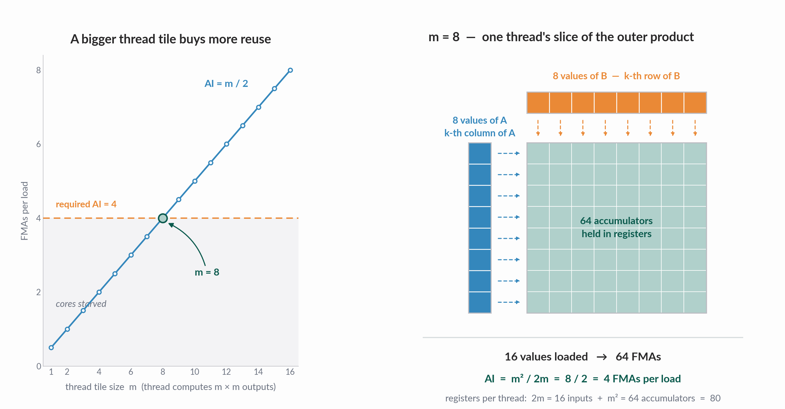
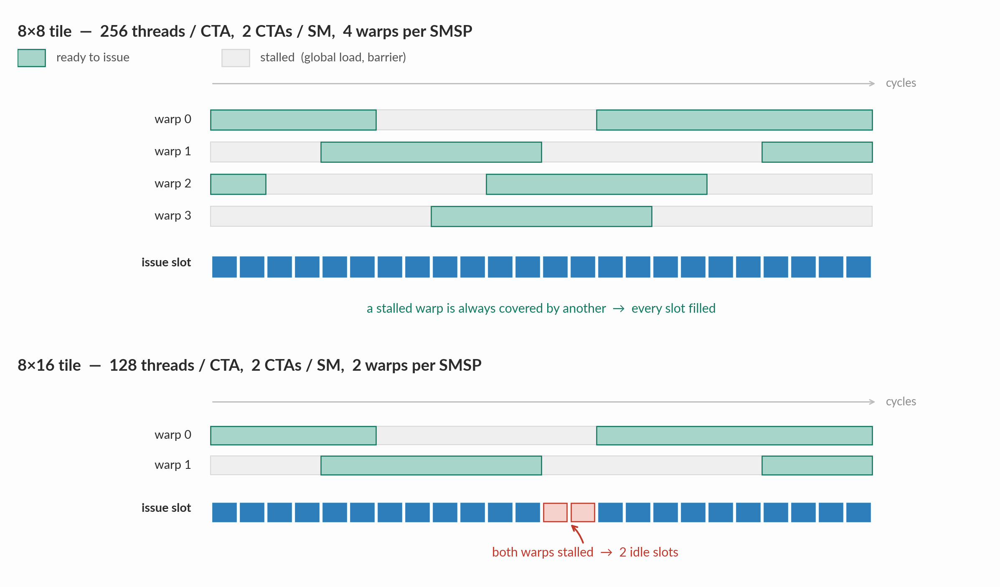

Matrix multiplication, the workload that dominates GPU time in deep learning, runs much slower than what the hardware is actually capable of when written in the straightforward way. This is not because the GPU lacks compute cores; rather, the compute cores remain idle while waiting for data to arrive.

GPUs have a tiered memory hierarchy, with each level being slower than the previous one: register file, shared memory (SMEM)/L1 cache, L2 cache, and global memory (GMEM, i.e. DRAM). The compute cores remain idle if data is fetched from slower memory tiers too often, or if memory requests stall due to inefficient access patterns such as shared-memory bank conflicts or uncoalesced global loads. The fix is to organize data across these tiers such that data loaded into a faster tier is reused as many times as possible before being evicted, and to group accesses so that they are conflict-free. This way, the compute cores are fed from the fastest tier with minimal memory stalls.

This blog post explores various optimization techniques and walks through the reasoning behind tile-size selection on the NVIDIA Tesla T4 GPU. It also includes calculations for the H100 to illustrate why different GPUs favor different tile sizes.

Note: We will not consider tensor cores in this discussion; the focus is solely on CUDA-core-based kernel development.

Throughout this post we will consider an FP32 matrix multiply `C = A × B`, where `A` is `M×K`, `B` is `K×N`, and `C` is `M×N`, with `M = N = K = 4096`.

Here are the numbers for both GPUs that we will keep coming back to:

| | T4 | H100 SXM |
|---|---|---|
| Architecture | Turing | Hopper |
| SMs | 40 | 132 |
| FP32 CUDA cores per SMSP | 16 | 32 |
| FP32 FMAs per SM per cycle | 64 | 128 |
| Boost clock | 1.59 GHz | 1.98 GHz |
| Peak FP32 throughput | 8.1 TFLOPs/sec | 67 TFLOPs/sec |
| DRAM | 16 GB GDDR6, 320 GB/sec | 80 GB HBM3, 3.35 TB/sec |
| L2 cache | 4 MB | 50 MB |
| Registers per SM | 65,536 | 65,536 |
| Max shared memory per SM | 64 KB | 228 KB |
| Shared memory bandwidth per SM | ~64 bytes/cycle | ~128 bytes/cycle |
| Shared memory load latency | ~22 cycles | ~30 cycles |
| Max threads per SM | 1024 | 2048 |

> **TODO:** Cite a source for every number in this table (NVIDIA datasheets for the specs; Jia et al. 2019, *Dissecting the NVidia Turing T4 GPU via Microbenchmarking*, for the T4 microarchitecture numbers). Two to reconcile: Jia et al. measured the T4's no-conflict shared-memory latency at **19 cycles** (the table says ~22), and an L2 miss at about **296 cycles** (TLB hit). Either use their numbers or measure your own, and keep the traces in Eliminating Idle Slots consistent with whichever you pick.

## Table of contents

## Where the FLOPs come from

Every SM is divided into 4 subpartitions known as SMSPs. Each SMSP has a warp scheduler which can issue one warp-wide instruction every cycle. A warp comprises 32 threads, and every thread's position in a warp is referred to as its lane (`0–31`). Each SMSP is also equipped with CUDA cores. On an H100, each SMSP hosts 32 FP32 CUDA cores; the T4 SMSP hosts 16 FP32 CUDA cores. The core count per SMSP decides how long a warp occupies the cores. Since a warp issues 32 FMAs per instruction, the H100's 32 FP32 cores retire a warp-wide FMA in a single cycle, matching the scheduler's issue rate. The T4's 16 cores need two cycles per warp, so its scheduler can only issue an FP32 FMA every other cycle and has to find other work, or run another warp, to fill the gap.

Each FP32 CUDA core can execute the FMA (fused multiply-add) instruction:

```text
c = a * b + c
```

Essentially, every FMA results in `2 FLOPs`: one multiplication and one addition. The CUDA cores are pipelined, allowing every core to perform `2 FLOPs` per cycle.

On the T4, every SMSP has a peak throughput of `2 FLOPs × 16 = 32 FLOPs` per cycle. The whole SM can sustain a peak throughput of `4 × 32 FLOPs = 128 FLOPs`, or `64 FMAs`, per cycle.

On an H100, every SMSP has a peak throughput of `2 FLOPs × 32 = 64 FLOPs` per cycle, and the whole SM can sustain `4 × 64 FLOPs = 256 FLOPs`, or `128 FMAs`, per cycle.

## Arithmetic Intensity of Matrix Multiplication

In the FMA operation `c = a * b + c`, the accumulator `c` is already present in the register file. The threads only need to load their `a` and `b` values into the register file to execute the FMA.

Arithmetic intensity (AI) is the ratio of computation performed to data moved from memory.

$$
\text{Arithmetic Intensity} = \frac{\text{Number of arithmetic operations}}{\text{Bytes transferred from memory}}
$$

For a single FMA, the AI is `2 FLOPs / 8 bytes` = `0.25 FLOPs per byte`, or 2 loads per FMA. A higher AI helps keep the cores busy for longer.

Now, let's compute the AI for matrix multiplication. There are two ways of computing `C = A × B`:

### Inner Product

$$
C_{rc} = \sum_{k=0}^{K-1} A_{rk} B_{kc}
\qquad (0 \le r < M,\; 0 \le c < N)
$$

Computing each output of `C` requires `K` multiplies and `K` adds, resulting in `K` FMAs. So the whole GEMM requires `M × N × K` FMAs, or `2MNK` FLOPs.

To compute each output, the algorithm walks along the `k` axis of both `A` and `B`, loading `K` values of `A` and `K` values of `B`. Computing the next output requires loading the next set of `A` and `B` values. Therefore, for `K` FMAs, the algorithm loads `2K` FP32 values, resulting in an AI of `0.5` FMAs per load.

### Outer Product

$$
C = \sum_{k=0}^{K-1} A_{:,k} \, B_{k,:}
\qquad (A_{:,k} \in \mathbb{R}^{M},\; B_{k,:} \in \mathbb{R}^{N})
$$

Here we swap the order of traversal and compute a partial product for all the output elements of `C` in steps of `k`. In every `k` step, the `k`-th column of `A` and the `k`-th row of `B` are fetched to compute a partial product for all the output elements. After `K` steps, all the output elements are fully computed.

Therefore, for `M × N` partial products, this algorithm performs `M × N` FMAs while loading only `M` values of `A` and `N` values of `B`. This results in an AI of

$$
\frac{MN}{M+N}
$$

`M + N` needs to fit within the register budget. Under the constraint that `M + N` is a constant, this expression is maximized when `M = N`, resulting in an AI of `0.5 × M` FMAs for every load. This is why square tiles are typically chosen: they have a higher AI.



Since both `M` and `N` are typically large, the outer product has a far higher AI than the inner product due to higher data reuse.

## Register Tiling

How much AI does it take to saturate the CUDA cores?

As we will see later, CUDA threads load data from GMEM into SMEM, so every load into the register file is served by shared memory.

On the T4, an SM sustains a peak throughput of `64` FMAs per cycle, and each FMA needs `2` FP32 operands. For a lane to issue an FMA, its operands must already be sitting in registers. But the T4 has only 4 load/store units per SMSP (half of what Volta has), and its shared-memory pipe delivers only about `64 bytes` (`16` FP32 values) per cycle into the register file. If every FMA used unique operands, the SM would need `64 × 2 = 128` FP32 values every cycle. Those `16` loaded values must therefore be shared across all `64` FMAs, which pins the required arithmetic intensity at `64 FMAs / 16 loads = 4 FMAs` per load.

On an H100, an SM sustains `128` FMAs per cycle, which would need `128 × 2 = 256` FP32 values every cycle if there was no reuse. Its shared-memory pipe delivers about `128 bytes` (`32` FP32 values) per cycle, which pins the required arithmetic intensity at `128 FMAs / 32 loads = 4 FMAs` per load.

Interestingly, both GPUs land on the same number. The T4 has half the FP32 cores per SM, but it also has half the shared-memory bandwidth, so the ratio between the two stays the same.

![The same comparison drawn for both GPUs. On the T4 an SM has 64 FP32 lanes and the shared-memory pipe hands over 16 values per cycle: without reuse those 16 values feed only 8 FMAs and 56 lanes sit idle, while at 4 FMAs per loaded value all 64 lanes stay busy. On the H100 an SM has 128 lanes and the pipe hands over 32 values per cycle: without reuse they feed 16 FMAs and 112 lanes sit idle, and again 4 FMAs per loaded value fills every lane. Both GPUs idle 87.5% of their lanes without reuse and both land on the same required intensity of 4](./required-arithmetic-intensity.png)

Now compare this against the outer product. A single `k` step needs `M` values of `A` and `N` values of `B` in the registers. Since `M` and `N` are both far too large to fit in the register file, every CUDA thread instead computes a small `m×n` tile of the output matrix and loads only `m + n` values. Assuming `m = n`, each thread computes an `m×m` output tile from `2m` loaded values, resulting in an AI of `m² / 2m = m/2`.

Therefore, for the outer product to sustain the SM's peak throughput,

`m / 2 = 4` → `m = 8`.

This means every thread must load at least `8` values of `A` and `8` values of `B` into its registers and compute an `8×8` output tile. The register budget for this is `2m = 16` registers for the inputs plus `m² = 64` registers for the accumulators, `80` registers per thread in total. This is well under the 255-registers-per-thread limit, which is the same on both the T4 and the H100.

Every thread is now responsible for computing an `8×8` tile of the output matrix. This is referred to as a **thread tile (TM, TN)** (or a lane tile), and this technique is referred to as **register tiling**.

Here is what the kernel looks like from a single thread's perspective:

```c
for k:
    load a[0..7], b[0..7]
    64 FFMAs using a, b
```



> Here, we assumed that `M + N` is a constant. However, with `M = N = 8`, a thread uses far fewer registers than its budget allows. Choosing a bigger tile size within the register budget can also improve the issue-slot efficiency, which we will see in the [Reducing Overhead Slots](#reducing-overhead-slots) section.

## Issue Slot Efficiency

The previous section went over how to load data into registers to hit an SM's peak compute throughput. That only matters, however, if the warp scheduler actually has an FMA to issue whenever the FMA pipe is free; if it does not, register tiling does not help. There are two reasons an FMA may not be issued in a given issue slot:

| Issue slot | What happens in that cycle | Example causes |
| --- | --- | --- |
| Overhead slot | Something issued, but it wasn't an FFMA | `LDS`, address math, loop branch, `__syncthreads` |
| Idle slot | Nothing issued: every warp on the SMSP is stalled | Waiting for a load to return, shared-memory pipe congested, barrier |

It is therefore useful to quantify the fraction of FMA issue opportunities that actually carry an FMA, since that is the metric we want to maximize:

```text
issue-slot efficiency η = FFMAs issued / FFMAs that could have been issued
```

On an H100, an FFMA can be issued every cycle, so this is simply the fraction of cycles that issued an FMA. On the T4, an FFMA can only be issued every other cycle, so the most it can issue in `N` cycles is `N / 2`. Normalizing this way puts both GPUs on the same scale, where `100%` means the FMA pipe is never left waiting.

This difference has an important consequence. On an H100, every overhead slot is a cycle that could have issued an FFMA. On the T4, the scheduler has a free issue slot every other cycle while the FMA pipe is still busy with the previous warp-wide FFMA. Overhead instructions such as `LDS`, branches, and integer address math (Turing has separate INT32 cores for this) can be issued in those free slots without taking anything away from the FMAs.

Overhead slots cannot be eliminated entirely: every thread still has to load its operands, compute addresses, advance the loop, and synchronize with its peers. Their cost can only be amortized by doing more compute per overhead instruction, which is exactly what a larger thread tile gives us.

### Eliminating Idle Slots

Idle slots, on the other hand, can be reduced by writing better kernel code.

Consider the code from the previous section:

```c
for k:
    load a[0..7], b[0..7]        // 16 LDS
    64 FFMAs using a, b          // must wait for the loads
```

On the T4, a shared-memory load (`LDS`) takes about 22 clock cycles when there are no bank conflicts. Tracing one `k` step through the scheduler:

```text
cycle   0-15  : issue 16 LDS                          (16 overhead slots)
cycle  16-29  : nothing to issue: the first FFMA needs
                a0 and b0, and b0 (issued at cycle 8)
                comes back at ~30                     (~14 idle slots)
cycle  30-157 : 64 FFMAs, one every other cycle       (128 cycles of FMA work)
-------------------------------------------------------------
~158 cycles for 64 FFMAs (128 at peak)  ->  η ≈ 81%
```

On an H100, an `LDS` takes about 30 clock cycles, and one `k` step looks like this:

```text
cycle   0-15  : issue 16 LDS                          (16 overhead slots)
cycle  16-37  : nothing to issue: the first FFMA needs
                a0 and b0, and b0 (issued at cycle 8)
                comes back at ~38                     (~22 idle slots)
cycle  38-101 : 64 FFMAs                              (64 useful slots)
-------------------------------------------------------------
~102 cycles for 64 FFMAs  ->  η ≈ 63%
```

The CUDA cores are idle during these idle slots, waiting for the data to be loaded. The T4 loses fewer cycles here for two reasons: its `LDS` latency is lower, and every `k` step takes twice as many cycles of FMA work, so the same 16 `LDS` instructions are a smaller fraction of the total.

Register prefetching removes the idle slots.

> **TODO:** Add a sentence saying the traces follow a single warp, i.e. a worst case. With 4 warps per SMSP, other warps fill most of these idle slots, which is why prefetching matters most when occupancy is low. Also note that nvcc already hoists the loads for `k+1` above the FFMAs of `k` when the loop is fully unrolled (see `regtile` vs `regtile_serial` in the code), so mention the compiler does this on its own.

#### Register Prefetching

The idea is to issue the `LDS` instructions for step `k+1` *before* running the FMAs for step `k`. When the loop reaches step `k+1`, its operands are already sitting in registers: the scheduler issues the `LDS` for step `k+2` and then immediately issues the FMAs.

```c
load a_next, b_next for k = 0
for k:
    a, b = a_next, b_next
    issue 16 LDS for k+1 → a_next, b_next
    64 FFMAs using a, b
```

On the T4, the 64 FMAs of step `k` take 128 cycles. The 16 `LDS` instructions for step `k+1` slip into the free issue slots between the FFMAs and land within about `31 + 22 = 53` cycles, so the memory load latency of step `k+1` is completely overlapped with the compute of step `k`.

```text
cycle 0: issue FFMA   → FP32 pipe busy cycles 0–1
cycle 1: issue LDS    → MIO; FP32 pipe still on the FFMA from cycle 0
cycle 2: issue FFMA   → FP32 pipe busy cycles 2–3
cycle 3: issue LDS    → MIO
...
```

Scheduler trace during step `k` on the T4:

```text
cycle   0-127 : 64 FFMAs for step k, on even cycles   (useful)
cycle   1-31  : 16 LDS for k+1, on odd cycles         (overhead, but in free slots)
                k+1's loads are back by ~53, well before cycle 128
-------------------------------------------------------------
128 cycles for 64 FFMAs  ->  η = 100%
```

On an H100, the 16 `LDS` instructions take up their own issue slots and land within about `15 + 30 = 45` cycles, while the 64 FMAs of step `k` take 64 cycles:

```text
cycle  0-15 : issue 16 LDS for k+1      (overhead)
cycle 16-79 : 64 FFMAs for step k       (useful)
              k+1's loads, issued 0-15, are back by ~45, well before cycle 80
-------------------------------------------------------------
80 cycles for 64 FFMAs  ->  η = 80%
```

Register prefetching raises η from ~81% to 100% on the T4, and from ~63% to 80% on the H100. This does not mean the T4 kernel will hit peak throughput: the trace only follows a single warp, and assumes the shared-memory pipe can keep up with all the warps on the SM, which, as we saw in register tiling, it only just can with an `8×8` tile.

Prefetching also comes at a cost. Each thread must now hold two sets of operands at once (the one it is computing with and the one it is prefetching), which increases the register budget from 80 to 96 registers per thread. This is referred to as **register double buffering**.

### Reducing Overhead Slots

Why stop at a thread tile size of 8×8? With register prefetching, an `m×n` tile needs at least `m·n + 2(m + n)` registers: `m·n` accumulators, plus two sets of `m + n` operands. On top of that come ~20–30 registers for addresses, loop counters and indices, and the hardware limit is 255 registers per thread. An 8×16 tile would need 176 registers before this overhead, still under the limit. A bigger tile has a higher arithmetic intensity, meaning we perform more FMAs per `LDS` instruction.

On an H100, fewer issue slots are then used up by `LDS`, which improves the issue-slot efficiency. On the T4, the `LDS` instructions already fit in the free slots between the FFMAs, as long as there are fewer `LDS` than FFMAs. Every tile below satisfies this, so the T4's ceiling is 100% for all of them.

| Tile | FFMAs / k | LDS / k | Ceiling η (T4) | Ceiling η (H100) | Registers (acc + 2× operands) |
|---|---|---|---|---|---|
| 4×4 | 16 | 8 | 100% | 67% | 16 + 16 = 32 |
| 8×8 | 64 | 16 | 100% | 80% | 64 + 32 = 96 |
| 8×16 | 128 | 24 | 100% | 84% | 128 + 48 = 176 |
| 16×16 | 256 | 32 | 100% | 89% | 256 + 64 = 320 > 255 ✗ |

So why not just use `4×4` on the T4? Because the issue slots are not the only constraint. As we saw in register tiling, the T4's shared memory can only keep up with the FMAs if every loaded value feeds at least `4` FMAs. A `4×4` tile only gives `2`, so the cores would wait on shared memory half the time. An `8×8` tile gives exactly `4`, which keeps the shared-memory pipe fully busy with no slack. An `8×16` tile gives `128 / 24 = 5.3` FMAs per load, leaving about 25% of the shared-memory bandwidth free for bank conflicts and for the stores that stage data into shared memory.

![Three panels. The first is shared by both GPUs: registers per thread grow with the tile area, from 32 at 4 by 4 to 96 at 8 by 8 to 176 at 8 by 16 to 320 at 16 by 16, which overshoots the 255-register limit and spills to local memory. The second panel is the T4, where the issue-slot efficiency ceiling is 100% for every tile because the LDS instructions fit in the free slots between the FFMAs; what rules out 4 by 4 there is shared memory, which only gets 2 FMAs per load against the 4 required. The third panel is the H100, where every LDS costs an FFMA issue slot, so the ceiling climbs from 67% to 80% to 84% to 89% and flattens out as the register bill grows](./tile-size-tradeoff.png)

On an H100, moving from an 8×8 tile to an 8×16 tile raises the issue-slot efficiency ceiling by only 4%, while consuming 80 more registers per thread. On the T4, it buys some shared-memory headroom, but nothing in terms of issue slots. A 16×16 tile doesn't fit on either GPU: 320 registers is over the limit, so the compiler would spill registers into local memory, which is per-thread storage that lives in global memory. Every access to a spilled value then needs an extra instruction:

- `STL` (store local) when the value is evicted
- `LDL` (load local) when it is needed again

These instructions add overhead slots, and waiting for the `LDL`s to return adds idle slots. That's the very problem we are trying to avoid, so choosing 16×16 would be counterproductive.

To see why 8×16 might also be problematic, let's assume a thread block (CTA) computes a 128×128 block of the 4096×4096 output matrix (we will justify this choice in the [Block Tiling](#block-tiling) section). The number of threads needed per block is:

threads per CTA = outputs per CTA / outputs per thread

For an 8×8 tile that is 16,384 / 64 = 256 threads, and for an 8×16 tile it is 16,384 / 128 = 128 threads. Including the bookkeeping registers, an 8×8 tile needs about 128 registers per thread and an 8×16 tile about 200. Both the T4 and the H100 have 65,536 registers per SM, so the numbers below are the same on both GPUs:

| Configuration | Threads/CTA | Regs/thread | Regs/CTA | CTAs per SM (65,536 regs) | Warps/SM | Warps/SMSP |
|---|---|---|---|---|---|---|
| 8×8, CTA 128×128 | 256 | ~128 | 32,768 | 2 | 16 | 4 |
| 8×16, CTA 128×128 | 128 | ~200 | 25,600 | 2 | 8 | 2 |

The T4 can hold at most 1024 threads (32 warps) per SM, half of the H100's 2048, but neither configuration comes close to that limit. The register file runs out first.

While 8×16 slightly raises the efficiency ceiling on the H100 and adds shared-memory headroom on the T4, it does so at the cost of halving the occupancy. Each SMSP's warp scheduler would only have 2 warps to choose from. If a warp stalls, for example on a global load or at a barrier, the scheduler is more likely to have no other work to pick up, and the idle slots go up.



So there are clear trade-offs in choosing the tile size. 8×8 is not a rule, and libraries often autotune tile sizes for each GPU and problem shape. For the rest of this blog, we will assume a thread tile size of 8×8.

### Register Bank Conflicts

> **TODO:** One or two lead-in paragraphs. Every tier we optimize has banks: the register file does too. Even with operands already in registers, an FFMA can be delayed if its source registers collide in a register bank. This is another source of idle slots that has nothing to do with memory.

#### How the Register File is Banked

> **TODO:** Explain the banking on Turing, citing the microbenchmarking paper (Jia et al., *Dissecting the NVidia Turing T4 GPU via Microbenchmarking*, 2019):
> - Register `Rn` lives in bank `n % 2` (2 banks, each 64 bits wide).
> - An FFMA reads 3 source registers. A conflict happens when all 3 fall in the same bank, and the instruction takes an extra cycle to read its operands.
> - The **operand reuse cache**: a `.reuse` flag on an operand keeps it cached for the next instruction in the same operand slot, so that read doesn't touch the register file at all.
> - Show one or two real SASS lines from `cuobjdump -sass`, e.g. `FFMA R10, R84.reuse, R92, R10`, and annotate the banks.
> - Say clearly that the H100's register file isn't publicly documented to the same level, so this section is T4-specific.

#### Why the Outer Product is Reuse-Friendly

> **TODO:** Explain why the 8×8 outer product suits the reuse cache. `a[i]` stays the same across the 8 FFMAs of a row (`acc[i][0..7] += a[i] * b[j]`), so the compiler can mark it `.reuse` and only `b[j]` and `acc[i][j]` are read from the register file. Note the catch: `LDS.128` writes 4 consecutive registers (`R4–R7`), so each fragment of `a` and `b` covers both banks. Where conflicts remain depends on which registers the compiler gives the accumulators.

#### Conflicts in the Compiled Kernels

> **TODO:** Show the static count of FFMAs whose 3 sources (after the reuse cache) are all in one bank, per kernel. With nvcc 13.0 I measured: `regtile`/`prefetch`/`warptile` 0%, `vectorized` ~4%, `swizzle`/`raster` ~2–3.5%, `dbuf`/`padding` ~13–15%. **Rerun with Colab's nvcc**, since this depends entirely on the compiler's register allocation.
> - Key point: the "most optimized" kernels got the worst allocation, purely as a side effect of `ptxas`. `dbuf` and `raster` have identical inner loops, yet for the 256 FFMAs per `k` tile where `a[i]` and `b[j]` share a bank, `ptxas` put the accumulator in the *other* bank for 224 of them in `raster`, and in the *same* bank for 198 of them in `dbuf`.
> - Explain why the accumulators are the only free choice: `LDS.128` fixes the banks of `a` and `b` (4 consecutive registers each), and although `STG.128` needs each `acc[i][0..3]` in 4 consecutive registers at the end, the compiler can move accumulators there for free by writing an FFMA's result to a different register than its accumulator input (e.g. `FFMA R109, R84, R90, R46`).
> - Caveats: these are static counts, not measured stalls. On the T4 the scheduler only issues an FFMA every other cycle, so a one-cycle read delay may be partly hidden; it likely matters more on the H100.
> - There's no direct Nsight counter for this that I know of. Check whether `smsp__warp_issue_stalled_dispatch_stall_per_warp_active.pct` moves between kernels, but don't claim it measures bank conflicts.
> - End by saying CUDA C gives no control over register allocation, and point forward to the SASS section.

## Warp Tiling

The `LDS` instructions we have seen so far are issued as warp-wide load instructions by the whole warp to shared memory. Each one carries the addresses requested by all 32 threads, each of which is loading data for its own `8×8` tile. The effective bandwidth with which SMEM delivers this data to the warp depends on which tiles the 32 threads are computing. If they are grouped such that the `LDS` leads to a lot of bank conflicts, that again leads to idle slots, as the `LDS` for step `k+1` can take longer than the compute in step `k`. This is what warp tiling addresses.

### Choosing the Lane Grid

Every one of the 32 threads in a warp computes a `TM × TN` = 8×8 thread tile of the output. A warp therefore computes 32 such thread tiles. How these 32 tiles are arranged within the output matrix determines which addresses are grouped into a warp's `LDS` instruction. This, in turn, determines whether the instruction is serviced by shared memory with bank conflicts, whether it can take advantage of broadcasts, and so on.

If bank conflicts occur, the `LDS` instruction takes longer to deliver all the required data, resulting in idle slots. On the other hand, if there are no bank conflicts and the data is shared across threads such that it can be broadcast, `LDS` can deliver the data much more efficiently and its latency can often be overlapped with compute. Both the T4 and the H100 have 32 shared-memory banks, each 4 bytes wide, so the analysis below holds for both.

Therefore, the placement of these 32 thread tiles within a warp is critical for minimizing idle slots and increasing issue-slot efficiency.

Now, assume the thread block (CTA) containing this warp computes a `BM × BN` = 128×128 output tile (more details in the block tiling section). At 8×8 (`TM × TN`) per thread, the CTA needs `(BM · BN) / (TM · TN) = 16,384 / 64 = 256` threads, or 8 warps.

Within a warp, the 32 lanes can be laid out as any `LM × LN` grid with `LM · LN = 32`, which makes the warp responsible for a **warp tile** of `WM = TM · LM` rows by `WN = TN · LN` columns. Each (row, column) position in the `LM × LN` lane grid refers to the `TM × TN` (8×8) thread tile owned by a single lane.

Below are the different possible arrangements of `LM × LN`:

| Lane grid `LM × LN` | Warp tile `WM × WN` | Unique `A` (= `WM`) | Unique `B` (= `WN`) | Total unique floats (Unique `A` + Unique `B`) | FMAs per float |
|---|---|---|---|---|---|
| 1×32 | 8×256 | 8 | 256 | 264 | 7.8 ✗ |
| 2×16 | 16×128 | 16 | 128 | 144 | 14.2 |
| 4×8 | 32×64 | 32 | 64 | **96** | **21.3** |
| 8×4 | 64×32 | 64 | 32 | **96** | **21.3** |
| 16×2 | 128×16 | 128 | 16 | 144 | 14.2 |
| 32×1 | 256×8 | 256 | 8 | 264 | 7.8 ✗ |

The `1×32` and `32×1` lane grids are not possible because the warp tile would be 8×256 or 256×8, and its 256-wide dimension exceeds the 128×128 CTA tile (`WN > BN` or `WM > BM`).


Among the remaining grids, `4×8` and `8×4` result in the fewest unique floats, allowing data to be broadcast while serving an `LDS` request from shared memory. Both also divide the CTA evenly: a 32×64 warp tile gives a 4×2 arrangement of the 8 warps, and a 64×32 warp tile gives a 2×4 arrangement.

The warp tile is the union of all 32 thread tiles assigned to a warp. Its dimensions are therefore:

```
(WM, WN) = (TM · LM, TN · LN)
```

Fewer unique floats is necessary but not sufficient. It sets how much data a warp needs per `k` step, but whether those floats can be read without bank conflicts depends on where each lane's 8 rows and 8 columns sit in shared memory. Note that a bank conflict can only occur between lanes of the *same* instruction: an `LDS` reads either from the `A` tile or from the `B` tile, never both, so an `A` value and a `B` value in the same bank never conflict with each other.

With the `4×8` grid and contiguous thread tiles (lane `(lm, ln)` owns rows `8·lm … 8·lm + 7` and columns `8·ln … 8·ln + 7`), the `A` loads are conflict-free: the 8 lanes with the same `lm` read the same address (a broadcast), leaving 4 distinct addresses at offsets 0, 8, 16 and 24, which fall in 4 different banks. The `B` loads are not. The 4 lanes with the same `ln` share an address, leaving 8 distinct addresses at offsets 0, 8, 16, …, 56. Since the 64-wide warp tile spans two rows of 32 banks, offsets 0 and 32 land in the same bank, as do 8 and 40, and so on: a 2-way bank conflict on every `B` load. The [Vectorized Shared-Memory Loads](#vectorized-shared-memory-loads) section fixes this by changing how each lane's columns are laid out, without changing the 96 unique floats.

> **TODO:** Add a small figure for this: the 8 distinct `B` addresses of one `LDS` (offsets 0, 8, …, 56) drawn against the 32 banks, showing the pairs that collide. Confirm with `profile.py smem warptile`: the `LDS` wavefronts per instruction should be above the ideal for kernel 05.

### Vectorized Shared-Memory Loads

> **TODO:** Draft available in `gemm-remaining-sections-draft.md`. Points to cover:
> - The table separating `LDG` (global → registers), `STS` (registers → shared) and `LDS` (shared → registers), with their latencies.
> - What vectorization buys: `LDS.128` cuts the H100's 8×8 issue-slot ceiling loss (80% → 94%), which removes most of the case for 8×16. On the T4 it relieves the MIO queue.
> - Alignment and contiguity: why `A` must be transposed, and why `B`'s 8 values are split into two 4-wide chunks 32 floats apart.
> - Bank conflicts with `LDS.128`: the 4 phases of 8 lanes, a contiguous thread tile gives a 2-way conflict, the strided split is conflict-free.
> - Note that nvcc already emits `LDS.128` for kernels 03–05 on its own. The strided layout in kernel 06 is what removes the conflict. Measure with `profile.py smem warptile vectorized`.

> Every tiling level lowers the bandwidth demand on the memory level below it by reusing each fetched value across more FMAs. Register tiling and warp tiling both protect shared-memory bandwidth, from two sides: register tiling reduces how many values each thread requests per FMA, while warp tiling arranges the lanes so that serving those requests costs fewer wavefronts (via broadcast and conflict-free access). Next, we will look at block tiling, which reuses each global-memory load across the whole CTA through shared memory, cutting L2/DRAM traffic.

Until now, we have assumed that the data required by the FMAs is already available in shared memory. In the next section we will see how this is done.

## Block Tiling

All the warps in an SM load their inputs from shared memory. At each `k` step, a single warp loads `WM` entries of the `k`-th column of `A` and `WN` entries of the `k`-th row of `B`. That is `WM + WN` floats per warp loaded from shared memory, and the SM hosts more than a single warp to hide latency. These values need to be staged into shared memory from global memory by the CTA before its warps can access them.

### Loading Tiles from Global to Shared Memory

> **TODO:** Short intro (draft in `gemm-remaining-sections-draft.md`). At every `k` tile the CTA loads a `128×8` tile of `A` and an `8×128` tile of `B`: 1024 floats each. With 256 threads, that's 4 floats of each per thread, so exactly one `LDG.128` each. Which 4 floats each thread loads decides whether the global loads are coalesced and whether the shared-memory stores conflict. Add a code snippet labeled `// from 06_vectorized.cu`.

#### Coalesced Global Loads

> **TODO:** Explain 32-byte sectors and coalescing (draft available).
> - `B` tile: lane `i` loads floats `4i … 4i+3` of a row, so a warp reads one 512-byte row: 16 sectors, all fully used.
> - `A` tile: rows are only 32 bytes (one sector). Two lanes share a row, so a warp covers 16 rows: 16 sectors, each fully used.
> - The bad case: one lane per row walking down column `k` gives 12.5% sector efficiency and 8× the DRAM traffic, undoing the block-tiling budget.
> - Measure: sectors per request from `profile.py global` (16 is ideal for a warp-wide `LDG.128`).

#### Transposing A

> **TODO:** Explain why `A` is stored transposed in shared memory (`As[k][m]`) (draft available).
> - The outer product needs a *column* of `A` per `k` step, which is strided in row-major `A`. Transposing makes it a contiguous, 16-byte-aligned row, ready for `LDS.128`.
> - Show the snippet: one `LDG.128`, then 4 scalar `STS` into `As[k0 + i][m]`.
> - Cost: 4 `STS` instead of 1 per thread per `k` tile, which is small next to 512 FFMAs.
> - Set up the bank conflict: with 128-float rows, the two lanes sharing a row write to the same bank (`bank = m mod 32`), a 2-way conflict. Point forward to Shared Memory Layout.
> - Optional: connect this to how CPU BLAS libraries pack matrices into tile-friendly layouts.

### Handling Matrix Edges

> **TODO:** Intro. Every kernel so far assumes `M`, `N` are multiples of 128 and `K` a multiple of 8, but real shapes (e.g. inference with odd batch sizes or hidden sizes) aren't. Explain what goes wrong without checks: out-of-bounds reads (garbage or a crash) and out-of-bounds writes to `C`. Explain why GEMM edges are cheap to handle: only the CTAs on the right and bottom edges, and the last `k` tile, are partial.

#### Predicated Loads and Stores

> **TODO:** Explain predication with a snippet from the boundary-checked kernel.
> - Guard each global load with a bounds check and **zero-fill** out-of-range elements in shared memory, so the outer product needs no checks at all (zeros contribute nothing to the sum).
> - Guard each store to `C` with a row/column check.
> - The vectorization catch: an `LDG.128` needs 4 in-bounds, 16-byte-aligned floats. If `K` or `N` isn't a multiple of 4, the edge needs scalar loads, or the whole kernel falls back to scalar.
> - Show the cost: compare the boundary-checked kernel against the unchecked one at 4096 (should be within noise), and at an awkward size like 4000 or 4095.
> - Mention the common trick of a fast path for full tiles and a checked path only for edge CTAs.

#### Padding the Matrices Instead

> **TODO:** The alternative: copy `A` and `B` into buffers padded up to multiples of the tile size, run the unchecked kernel, and copy out the valid part of `C`. Compare costs: the copy is O(n²) memory traffic against the GEMM's O(n³) compute, so it's cheap for big square GEMMs but expensive for small or skinny ones. Say which approach you used and why.

### Shared Memory Double Buffering

> **TODO:** Draft available in `gemm-remaining-sections-draft.md`. Points to cover:
> - The single-buffered loop: `LDG`, `STS`, barrier, compute, barrier. Nothing can overlap the global-load latency.
> - The cost table: 4096 cycles of FMA work per `k` tile on the T4 (2 CTAs per SM), 2048 on the H100, against several hundred cycles of `LDG` latency. **Replace the assumed 500 cycles with a measured value** (Jia et al. report about 296 cycles for an L2 miss on the T4, and 616 on a first access that also misses the TLB).
> - The double-buffered loop: `LDG` tile `t+1` into staging registers, compute tile `t`, `STS` into the other buffer, one barrier. Explain why one barrier is enough.
> - Costs: 16 KB of shared memory per CTA instead of 8 KB, and 8 staging registers per thread.
> - Measure: `long_scoreboard` stalls should drop sharply from `vectorized` to `dbuf` (`profile.py stalls`).
> - Aside: `cp.async` (Ampere+) and TMA (Hopper) remove the staging registers. The T4 has neither.

### Block Tile Dimension

Let's say a CTA is responsible for computing a `BM × BN` tile of the output matrix `C`. This means that at each `k` step, the CTA loads `BM` entries of column `k` of `A` and `BN` entries of row `k` of `B` from global memory into shared memory.

All the threads in this CTA then perform the outer product, loading `BM + BN` floats and computing `BM · BN` FMAs. Since every FMA is `2 FLOPs` and every float is `4 bytes`, this results in an AI of

$$
\text{AI} = \frac{2 \cdot BM \cdot BN}{4 \cdot (BM + BN)} = \frac{BM \cdot BN}{2 \cdot (BM + BN)} \ \text{FLOPs per byte}
$$

Since shared memory is limited, `BM + BN` has to stay within a budget. Under this constraint, the AI is maximized when `BM = BN = B`, resulting in an AI of `B / 4` FLOPs per byte.

The threads in a CTA can also choose to load `BM` entries of `A` and `BN` entries of `B` across multiple `k` steps at once, say `BK` of them. This does not affect the AI, since the FLOPs performed would be `BK` times higher and the floats loaded would also be `BK` times higher, canceling out in the AI equation. What it does achieve is fewer trips to GMEM, at the cost of a higher shared memory footprint. SMEM per CTA is then `BK · (BM + BN) · 4` bytes, and double that with double buffering.

#### Lower Limit for B

The lower limit for `B` is set by the condition that GMEM does not become the bottleneck. To be conservative, we assume that L2 does not help, and every byte loaded by a CTA comes from DRAM.

The documented boost clock of the T4 is 1.59 GHz. With 40 SMs, each performing `128 FLOPs` per cycle, this results in a peak throughput of `40 × 128 × 1.59 GHz ≈ 8.1 TFLOPs/sec`. Its GDDR6 memory supports a bandwidth of `320 GB/sec`.

To prevent DRAM transfers from being the bottleneck, we need a minimum AI of

$$
\frac{8.1 \ \text{TFLOPs/sec}}{0.32 \ \text{TB/sec}} \approx 25 \ \text{FLOPs per byte}
$$

$$
\implies \frac{B}{4} \geq 25 \implies B \geq 100
$$

> The T4 is a 70 W card, and under a dense FP32 workload it often cannot hold its boost clock, which lowers the peak throughput and therefore the required AI. On the other hand, the achievable GDDR6 bandwidth is also lower than `320 GB/sec`, which pushes it back up. We will use `25 FLOPs per byte` as the target, and check both the actual clock and the achieved DRAM bandwidth in Nsight once we run the kernels.

The documented boost clock of the H100 SXM is 1.98 GHz, resulting in a peak throughput of `67 TFLOPs/sec`. HBM3 supports a bandwidth of `3.35 TB/sec`. The minimum AI is

$$
\frac{67 \ \text{TFLOPs/sec}}{3.35 \ \text{TB/sec}} = 20 \ \text{FLOPs per byte}
$$

$$
\implies \frac{B}{4} \geq 20 \implies B \geq 80
$$

> However, the H100's sustained clock rate is about 1.75 GHz to keep power consumption in check under dense FP32 workloads, resulting in a peak throughput of about `59 TFLOPs/sec`. This lowers the required AI to about `17.6 FLOPs per byte`. On the other hand, the achievable HBM bandwidth is also lower than `3.35 TB/sec`, which pushes it back up. We will use `20 FLOPs per byte` as a slightly conservative target.

Notice that the T4 actually needs a *higher* arithmetic intensity than the H100. The H100 has about `8×` the FP32 compute of the T4, but about `10×` its memory bandwidth, so every byte from DRAM has to be stretched further on the T4.

For a square block tile, `B` must be at least `100` on the T4, and at least `80` on the H100.

#### Upper Limit for B

Big tile sizes require more threads, and every thread requires registers for its accumulators, inputs and other bookkeeping.

As we saw earlier, a thread with an `8×8` thread tile requires about `128` registers and produces `64` outputs. A CTA with a `B×B` block tile produces `B²` outputs. Therefore,

$$
\text{threads per CTA} = \frac{B^2}{64}
$$

$$
\text{registers per CTA} = \frac{B^2}{64} \times 128 = 2B^2
$$

Both the T4 and the H100 have `65,536` registers per SM, and the whole CTA must fit on a single SM. Therefore,

$$
2B^2 \leq 65{,}536 \implies B \leq \sqrt{32{,}768} \approx 181
$$

So for square block tiles, the final inequalities become

$$
\text{T4:} \quad 100 \leq B \leq 181
$$

$$
\text{H100:} \quad 80 \leq B \leq 181
$$

`B` also needs to divide evenly into warp tiles of `32×64`, and powers of two keep the index math to shifts and masks. The only power of two in either range is `128`. The window is narrower on the T4, but it still lands on the same tile.

#### Candidates

Here is how the different block tile sizes compare against the `25 FLOPs per byte` target on the T4 and the `20 FLOPs per byte` target on the H100:

| CTA tile  | FLOPs/byte | vs. 25 (T4) | vs. 20 (H100) | Verdict                                         |
|-----------|-----------:|------------:|--------------:|-------------------------------------------------|
| 32×32     | 8.0        | 0.32×       | 0.40×         | DRAM-bound on both                              |
| 64×64     | 16.0       | 0.64×       | 0.80×         | DRAM-bound without L2 help on both              |
| 64×128    | 21.3       | 0.85×       | 1.07×         | DRAM-bound on the T4; no margin on the H100     |
| 96×128    | 27.4       | 1.10×       | 1.37×         | clears both; awkward warp decomposition         |
| **128×128** | **32.0** | **1.28×**   | **1.60×**     | **clears both, with headroom**                  |
| 256×128   | 42.7       | 1.71×       | 2.13×         | more margin, at a price (only 1 CTA per SM)     |
| 256×256   | 64.0       | 2.56×       | 3.20×         | cannot launch (exceeds the register file)       |

Notice that `64×128`, which nominally clears the target on the H100, falls short on the T4. And the headroom that `128×128` has is smaller on the T4 (`1.28×`) than on the H100 (`1.60×`).

> **TODO:** Answer this in a sentence or two. 96×128 needs 192 threads (6 warps), which tile it as 3×2 warp tiles of 32×64, so the warp layout itself works. The awkward parts are elsewhere: 4096 / 96 isn't an integer (so the last row of tiles needs boundary handling), the index math needs divisions by 3 instead of shifts, and 6 warps don't spread evenly over the 4 SMSPs.

Keep in mind that this assumes every byte comes from DRAM. In practice, CTAs that share rows of `A` or columns of `B` get some of their data from L2, which lowers the DRAM traffic further. The T4's L2 is only `4 MB` compared to the H100's `50 MB`, so we have less room to lean on it.

![Arithmetic intensity grows as B over 4 with the square block tile side, drawn once per GPU. On the T4 the floor is the 25 FLOPs per byte line, so B must be at least 100; on the H100 the floor is 20 FLOPs per byte and B need only reach 80. Both share the same ceiling: above B equals 181 the CTA needs more than the 65,536 registers of an SM and cannot be resident. 128 is the only power of two inside either window, landing at 32 FLOPs per byte. The ladder of candidate CTA tiles below scores each one against both targets: 32 by 32 and 64 by 64 fall short on both, 64 by 128 clears the H100 by 1.07 times but misses the T4 at 0.85 times, and 128 by 128 clears both with 1.28 times on the T4 and 1.60 times on the H100](./block-tile-bounds.png)

#### Is 128×128 the Best We Can Do?

The square tile argument assumed that shared memory was the budget. So let's check how much shared memory a `128×128` block tile actually uses. With `BK = 8` and double buffering:

$$
2 \times 8 \times (128 + 128) \times 4 \ \text{bytes} = 16 \ \text{KB per CTA}
$$

The register file allows `2` such CTAs per SM, so together they use `32 KB` of shared memory.

On the T4, an SM has at most `64 KB` of shared memory (Turing splits a `96 KB` block between L1 and shared memory), so two CTAs use half of it. Shared memory is much tighter here than on the H100. With `BK = 16`, each CTA uses `32 KB` and two CTAs fill all `64 KB`. With `BK = 32`, each CTA would use `64 KB`, and only one CTA would fit on the SM.

On an H100, the two CTAs use `32 KB` out of the `228 KB` available per SM. Even with `BK = 32`, each CTA uses only `64 KB`, or `128 KB` for two. Most of the shared memory is left unused.

So at `BK = 8`, the budget that actually limits us on both GPUs is the register file. The register file limits the *area* of the tile, `BM · BN` (the accumulators), and not `BM + BN`. For a fixed area, a square tile still has the highest AI, but nothing forces us to keep the area fixed. Let's look at bigger tiles: `256×128` and `256×256`.

##### 256×256

Plugging `BM = BN = 256` into the formulas above,

$$
\text{threads per CTA} = \frac{256 \times 256}{64} = 1024
$$

$$
\text{registers per CTA} = 1024 \times 128 = 131{,}072
$$

This is twice the size of the SM's register file on both GPUs.

##### 256×128

Plugging `BM = 256` and `BN = 128` into the formulas,

$$
\text{threads per CTA} = \frac{256 \times 128}{64} = 512
$$

$$
\text{registers per CTA} = 512 \times 128 = 65{,}536
$$

This uses exactly the whole register file. The CTA fits, but there is no room for a second CTA on the same SM. Its 16 warps are arranged as `8×2` warp tiles of `32×64`, and it uses only `2 × 8 × (256 + 128) × 4 bytes = 24 KB` of shared memory.

Since both GPUs have the same register file, the table below holds for both. Only the shared memory available differs: `64 KB` per SM on the T4 and `228 KB` on the H100.

| Configuration | Threads/CTA | Regs/CTA | CTAs/SM | Warps/SM | Warps/SMSP | SMEM/SM | AI (FLOPs/byte) | DRAM traffic (4096³) |
|---------------|------------:|---------:|--------:|---------:|-----------:|--------:|----------------:|--------------------:|
| 128×128       | 256         | 32,768   | 2       | 16       | 4          | 32 KB   | 32.0            | 4.29 GB             |
| 256×128       | 512         | 65,536   | 1       | 16       | 4          | 24 KB   | 42.7            | 3.22 GB             |
| 256×256       | 1024        | 131,072  | 0 ✗     | —        | —          | —       | 64.0            | —                   |

Notice that both configurations have the same number of warps per SM, and therefore the same `4` warps per SMSP for the warp scheduler to choose from. The difference is that with `128×128`, those warps belong to two independent CTAs, while with `256×128` they all belong to one.

#### One Big CTA or Two Small Ones?

The warps in a CTA are tied together by `__syncthreads`. This is where having two CTAs per SM helps:

- **Barriers:** With two `128×128` CTAs, a `__syncthreads` stalls only the 8 warps of its own CTA. While they wait for the slowest warp, or for a global load that was not fully hidden, the 8 warps of the other CTA can keep issuing FFMAs. With a single `256×128` CTA, all 16 warps wait at the same barrier at every `k` tile, and the slowest warp holds up the whole SM.
- **Prologue and epilogue:** Every CTA starts by loading its first tile, with no compute to overlap it with, and ends by writing its output tile to `C`. With two CTAs per SM, one CTA is usually computing while the other is starting or finishing. With one CTA per SM, the SM sits idle during every prologue and epilogue.
- **Small problems:** Bigger tiles mean fewer CTAs. For a `1024×1024×1024` matrix multiply, `128×128` results in 64 CTAs, while `256×128` results in only 32 CTAs. That leaves 8 of the T4's 40 SMs with nothing to do, and 100 of the H100's 132 SMs.

![Schematic SM timelines for the two configurations, which hold on both GPUs since each puts 16 warps on an SM. With two 128 by 128 CTAs, the barriers of CTA 0 and CTA 1 are independent and fall at different times, so whenever one CTA is waiting at a __syncthreads the other still has FFMAs to issue and the SM loses only its prologue. With one 256 by 128 CTA, all 16 warps wait at the same barrier, so every barrier, along with the prologue and the epilogue, leaves the SM with nothing to issue. A panel below compares the DRAM bandwidth each configuration needs: on the T4 128 by 128 asks for 254 GB/sec, about 80% of the 320 GB/sec GDDR6 peak, against 191 GB/sec for 256 by 128; on the H100 the same two configurations need 2.1 and 1.6 TB/sec out of 3.35 TB/sec, leaving plenty of margin](./one-cta-vs-two.png)

> **TODO:** Add an aside on how this trade-off changes on Hopper. Shared memory is one budget, spent either on depth (more pipeline stages per CTA, which hides memory latency; by Little's law, stages needed ≈ bytes per second needed × latency / bytes per stage) or on breadth (more CTAs per SM, which hides whole-CTA stalls: barriers, prologue, epilogue). The T4 kernels pick breadth because every `k` tile ends in a `__syncthreads`. Hopper GEMMs pick depth (typically one CTA per SM with 4+ stages), because warp specialization (a TMA producer warp and consumer warpgroups), per-stage mbarriers instead of CTA-wide barriers, persistent kernels and ping-pong consumer warpgroups provide what the second CTA was for. Keep it short and point to the Hopper post.

So when would `256×128` be worth giving up the second CTA? Only when the FLOPs-per-byte target no longer holds, which can happen in two ways:

- **The GEMM gets less DRAM bandwidth than we assumed.** At peak compute, the `4096³` GEMM takes about `17 ms` on the T4 and about `2 ms` on the H100. Moving `4.29 GB` in that time, `128×128` needs about `254 GB/sec` on the T4 and `2.1 TB/sec` on the H100. `256×128` needs only `191 GB/sec` and `1.6 TB/sec` respectively. On the H100, the GEMM has plenty of margin unless other kernels running at the same time eat into its share. On the T4, `254 GB/sec` is about `80%` of the `320 GB/sec` peak, which is close to what GDDR6 sustains in practice.

- **The compute rate is much higher.** FP16 tensor cores deliver about `65 TFLOPs/sec` on the T4 and about `989 TFLOPs/sec` on the H100, which raises the target to about `200` and `300 FLOPs per byte` respectively. No block tile reaches that from DRAM alone, so tensor-core kernels rely on L2 reuse and use the biggest tiles that fit, typically `128×256` or `256×128`.

On the H100, neither applies to our FP32 GEMM. On the T4, the first one is close to the edge, but the clock throttling we discussed earlier lowers the compute rate and therefore the bandwidth we need, and CTAs sharing rows of `A` and columns of `B` still get some of their data from L2. So for the rest of this blog we will assume a block tile size of `128×128`, and check the achieved DRAM throughput in Nsight to see how close to the edge we actually are.

> Block tiling lowers the bandwidth demand on global memory by reusing each value loaded into shared memory across the whole CTA. Shared memory decides how deep (`BK`) a block tile can be, but the register file decides how big (`BM × BN`) it can be. On both GPUs the register file runs out first, though on the T4 shared memory is not far behind. Within this budget, `128×128` clears the DRAM target on both GPUs, with plenty of room on the H100 and less on the T4, so we spend the remaining budget on a second CTA per SM to hide latency, rather than on a bigger tile.

### Shared Memory Layout

> **TODO:** One-paragraph intro. Recall the 2-way conflict on the transposed stores into `As` (128-float rows, two lanes per row writing to the same bank) and introduce the two fixes: padding and swizzling.

#### Padding

> **TODO:** Draft available. Points to cover:
> - `As[2][BK][BM + PAD]`. Why `PAD = 1` fixes the conflict but breaks `LDS.128` alignment (rows of 516 bytes).
> - `PAD = 4`: rows of 132 floats keep 16-byte alignment, and rows `k` and `k+4` are now 16 banks apart (`bank = (4k + m) mod 32`).
> - The bank table (stride 128 vs 132) and the cost: 256 bytes per CTA, negligible even on the T4.
> - Measure: STS wavefronts per instruction should drop from ~2 to 1 (`profile.py smem dbuf padding`).

#### Swizzling

> **TODO:** Draft available. Points to cover:
> - XOR the column index with bits of the row index: physical column `m ^ ((k >> 2) << 4)`, i.e. rows 4–7 shift by 16 floats (16 banks).
> - Readers must apply the same XOR. Since only bit 4 changes, 4-float chunks move as a whole and stay aligned for `LDS.128`.
> - The comparison table (memory cost, conflicts, `LDS.128` compatibility, index math) and the figure with 128-wide, padded and swizzled tiles.
> - Why it matters later: Hopper's TMA writes dense tiles with no room for padding, and swizzles in hardware (32/64/128-byte patterns).

## Scheduling CTAs Across the GPU

> **TODO:** Short intro. Everything so far optimized what happens *inside* a CTA. The last two questions are about the grid as a whole: which CTAs run at the same time (L2 reuse), and how evenly the CTAs fill the SMs (wave quantization).

### CTA Rasterization

> **TODO:** Draft available in `gemm-remaining-sections-draft.md`. Points to cover:
> - CTAs in the same output row share `A` panels; CTAs in the same column share `B` panels. Reuse through L2 only happens if they run at the same time.
> - Residency: 80 CTAs at a time on the T4 (40 SMs × 2), 264 on the H100, so 1024 CTAs is ~13 and ~4 waves.
> - Row-major launch order vs grouped (`GROUP_M`): distinct tiles per `k` tile drop from 35 to 18 on the T4, and 41 to 33 on the H100. Include the two ASCII diagrams and the remapping snippet.
> - Why the T4 benefits more: few resident CTAs, a small 4 MB L2, and DRAM bandwidth already near the edge.
> - Measure: sweep `GROUP_M = 1, 2, 4, 8, 16` with `profile.py l2 raster`; plot L2 hit rate and DRAM bytes read.
> - Caveat: the numbers assume CTAs in a wave run in lockstep, which they don't.
> - Be honest about the expected gain. The minimum L2 hit rate a kernel needs is `1 − (tile FLOPs per byte) / (ridge FLOPs per byte)`. For the FP32 `128×128` tile that's `1 − 32/25 < 0` on the T4 (and `1 − 32/20` on the H100): L2 reuse is *not required*, only margin. But the margin is thin on the T4 (254 GB/sec, ~80% of peak DRAM bandwidth at full FP32 speed), so check `dram__throughput` for `dbuf`/`padding` first. If it's well below ~70% of peak, predict a small gain from rasterization; if it's near ~75% or more, predict a measurable one. Then confirm with the `GROUP_M` sweep either way.
> - Other reasons it can still help on the T4: L2 hits are faster than DRAM (about 188 vs 296 cycles, per Jia et al.), which is easier for double buffering to hide; and smaller tiles (e.g. `64×64`, 16 FLOPs per byte) *do* need it, at least `1 − 16/25 ≈ 36%` hits.
> - Contrast with tensor cores in one paragraph: a `128×128` FP16 tile delivers 64 FLOPs per byte against ridges of about 203 (T4) and 295 (H100), so it needs at least 68% and 78% L2 hits. Rasterization goes from optional to essential, which sets up the tensor-core post. (The H100 worked example PDF has the full derivation.)

### Wave Quantization

> **TODO:** Explain how CTAs are scheduled in waves of (SMs × CTAs per SM): 80 on the T4, 264 on the H100. If the CTA count isn't a multiple of that, the last wave is partly empty.
> - 4096³ with `128×128` tiles: 1024 CTAs is 12.8 waves on the T4 (~98% efficient) and 3.88 waves on the H100 (~97%). Hardly matters.
> - 1024³: only 64 CTAs. That fills 80% of the T4's slots, and just 24% of the H100's. Most of the H100 sits idle.
> - Formula: efficiency = waves / ⌈waves⌉. Add a plot of efficiency vs matrix size for both GPUs (a sawtooth).
> - Measure: run the harness at a few sizes (e.g. 512, 1024, 1536, 2048, 4096) and compare TFLOPs/sec against the predicted efficiency.
> - Tie back to the "Small problems" bullet in One Big CTA or Two Small Ones?, and lead into split-K as the fix.

#### Split-K

> **TODO:** Explain split-K: divide the `k` dimension into `S` slices, give each slice its own CTA (so `S×` more CTAs), and sum the partial `C` tiles at the end.
> - Two ways to reduce: `atomicAdd` into `C` (simple, but nondeterministic summation order), or write partials to a workspace and run a small reduction kernel.
> - Cost: each extra slice writes and reads a full `M×N` partial result, so it only pays off when `M×N` is small relative to `K`.
> - Example: 1024×1024×4096 on the H100 with `S = 4` gives 256 CTAs (~97% of one wave) instead of 64 (24%).
> - Measure: compare `S = 1, 2, 4, 8` on the H100-sized problem, or on the T4 with an even smaller `M×N` and a large `K`.
> - Mention stream-K (used by CUTLASS) as the more general version, and leave it for the Hopper post.

## Autotuning

> **TODO:** Intro. The post derived `8×8` and `128×128` from first principles, but several choices were close calls (`BK`, `8×8` vs `8×16`, `GROUP_M`, `128×128` vs `256×128`), and the best choice depends on the problem shape. Autotuning means compiling several configurations and picking the fastest by measurement. This section checks how well the paper analysis predicted the winner.

### The Search Space

> **TODO:** Describe the parameters and the constraints that prune them.
> - Parameters: `BM`, `BN` (64, 128, 256), `BK` (8, 16, 32), thread tile `TM×TN` (4×4, 8×8, 8×16), warp layout, `GROUP_M`, and split-K `S`.
> - Constraints from the post: registers per thread ≤ 255 (no spills), registers per CTA vs the 65,536 register file, shared memory per CTA vs the T4's 64 KB, and divisibility (warp tiles must tile the CTA tile).
> - Implementation: templated kernel, a list of valid configurations generated at compile time, and the harness timing each one. Mention how long the full sweep takes on the T4.

### Best Configurations on the T4

> **TODO:** Report the winners for a few shapes: a big square GEMM (4096³), a small one (1024³), and one or two inference-like skinny shapes (e.g. `M = 16` or `64` with `N = K = 4096`).
> - Table: shape, best configuration, TFLOPs/sec, and how far the post's default (`128×128`, `8×8`, `BK = 8`) is from the best.
> - Discuss where the first-principles analysis was right and where it was wrong. This is one of the most valuable paragraphs in the post.
> - Optional: compare against what cuBLAS picks (visible as the kernel name in `ncu`).

## Results

> **TODO:** Intro. Each optimization was motivated by a number computed on paper, so this section checks those numbers against the hardware. State up front which GPU the results are from. If the H100 numbers are only predictions, say so here.

### Nsight Measurements

> **TODO:** Draft available in `gemm-remaining-sections-draft.md`. Fill in:
> - The progression table (one row per kernel, with a link to its file): ms, TFLOPs/sec, % of peak, plus cuBLAS. Use `./gemm all 4096 20`. Compute % of peak with the *measured* clock.
> - Prediction vs measurement for each key claim: real clock, DRAM bandwidth (~80% predicted for `128×128`), η per kernel, STS/LDS wavefronts per instruction, `long_scoreboard` drop from double buffering, L2 hit rate vs `GROUP_M`.
> - A short "what I got wrong" note for every claim that didn't hold, with your best explanation.
> - Mention that the profiles used `--clock-control none` and why.
> - One or two Nsight Compute screenshots (e.g. the memory chart or the source view with stalls).

## Going Below CUDA C: Fixing Register Bank Conflicts in SASS

> **TODO:** Intro. Register Bank Conflicts showed the problem; CUDA C can't fix it, because `ptxas` owns register allocation. This section edits the compiled SASS of the final kernel directly, using CuAssembler (which supports `sm_75`). Briefly say what SASS is, and why NVIDIA's own libraries still ship hand-tuned kernels.

### Reading the SASS

> **TODO:** The workflow and the diagnosis.
> - Compile to a cubin (`nvcc -cubin -arch=sm_75`), disassemble with CuAssembler into an editable `.cuasm` file, reassemble, and load the cubin from the harness with `cuModuleLoad` + `cuLaunchKernel`.
> - Walk through the inner loop of the final kernel: the `LDS.128`s, the 64 FFMAs per `k` step, `.reuse` flags, and the control codes (stall counts, yield, scoreboard barriers) at a high level.
> - Point at specific FFMAs with all 3 sources in one bank, using the conflict-counting script.

### Reordering FFMAs and Reuse Flags

> **TODO:** Explain the fix (study guide, section 6.4).
> - The fragment banks are fixed: `LDS.128` writes 4 consecutive registers, so `a[i]` is in bank `i mod 2` and `b[j]` in bank `j mod 2`.
> - Run each row's 8 FFMAs (`acc[i][0..7]`) back-to-back with `a[i]` in slot A and `.reuse` set. Only the first FFMA of the row then reads `a[i]` from the register file; the other 7 read just two registers and can't conflict.
> - Start each row with a `j` whose `b[j]` is in the other bank from `a[i]` (odd `j` for even `i`, and vice versa). Then none of the 64 FFMAs has all three sources in one bank.
> - Correctness rules: reorder only independent FFMAs within one `k` step, keep wait masks and stall counts on their positions, don't cross the `LDS` instructions, keep each row contiguous, check the loop-carried distance between steps, and avoid `.reuse` after a yield.
> - The rejected alternative (renaming accumulators into the other bank): `STG.128` needs each `acc[i][0..3]` in 4 consecutive registers, so a rename has to stay inside the loop and add `MOV`s afterwards. Inserting instructions is risky without control-flow support in the assembler. One paragraph on why you didn't do it this way.

### Before and After

> **TODO:** Show the result.
> - Conflict count before and after (from the script), and the correctness check against cuBLAS (hand-edited cubins can be silently wrong).
> - TFLOPs/sec and issue metrics (η, FMA pipe %, dispatch stalls) for nvcc's cubin vs the edited one.
> - If the gain is small on the T4, explain why (FFMA issue every other cycle, 4 warps per SMSP to hide delays) and what you'd expect on the H100. A small gain is still a valid result.

## Conclusion

> **TODO:** Draft available in `gemm-remaining-sections-draft.md`. Update it for the new sections:
> - One line per level of the hierarchy: register tiling, register prefetching and vectorized loads, warp tiling, block tiling, double buffering and padding/swizzling, rasterization and wave quantization, plus the SASS edit.
> - The final number: % of cuBLAS reached on the T4.
> - The CPU-engineer perspective: same answer (`8×8`, `128×128`) on two very different GPUs, but different margins.
> - What you got wrong along the way, in one or two sentences.
> - Lead-in to the next post: tensor cores on the T4.