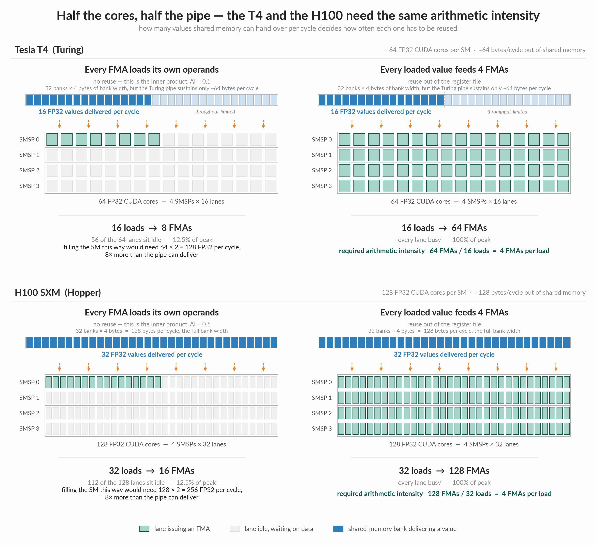
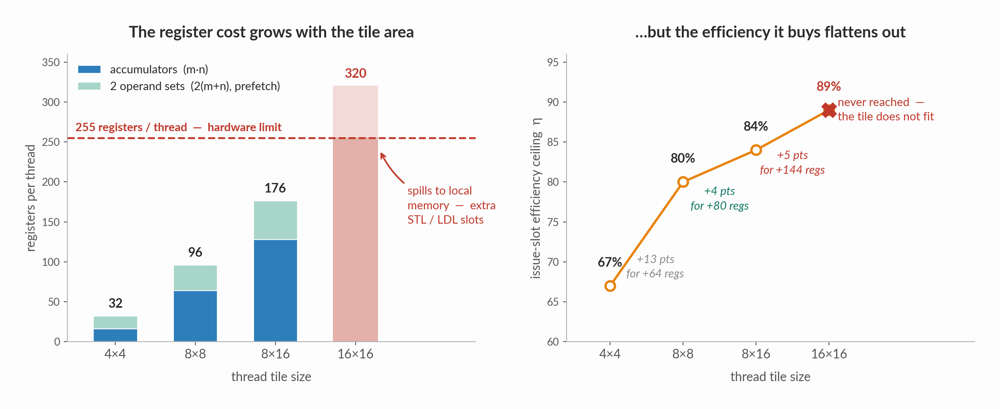

Matrix multiplication, the workload that dominates GPU time in deep learning, will run much slower than what the hardware is actually capable of when written in the straightforward way. This is not because the GPU lacks compute cores; rather, the compute cores remain idle while waiting for data to arrive.

GPUs have a tiered memory hierarchy, with each level being larger but slower than the previous one: register file, shared memory/L1 cache, L2 cache, and global memory (HBM). The compute cores remain idle if data is fetched from slower memory tiers too often, or if memory requests stall due to inefficient access patterns such as shared-memory bank conflicts or uncoalesced global loads. The fix is to organize data across these tiers such that data loaded into a faster tier is reused as many times as possible before being evicted, and to group accesses so that they are conflict-free. This way, the compute cores are fed from the fastest tier with minimal memory stalls.

Throughout this post we will consider an FP32 matrix multiply `C = A × B`, where `A` is `M×K`, `B` is `K×N`, and `C` is `M×N`, with `M = N = K = 4096`.

## Table of contents

## Where the FLOPs come from

Every SM is divided into 4 subpartitions known as SMSPs. Each SMSP has a warp scheduler which can issue one warp-wide instruction every cycle. A warp comprises 32 threads, and every thread's position in a warp is referred to as its lane (`0–31`). Each SMSP is also equipped with CUDA cores. On an H100, each SMSP hosts 32 FP32 CUDA cores; the A100 SMSP hosts 16 FP32 CUDA cores. The core count per SMSP is what decides how long a warp occupies the cores. Since a warp issues 32 FMAs per instruction, the H100's 32 FP32 cores retire a warp-wide FMA in a single cycle, matching the scheduler's issue rate. The A100's 16 cores need two cycles per warp, so its scheduler can only issue an FP32 FMA every other cycle and has to find other work, or run another warp, to fill the gap.

Each FP32 CUDA core can execute the FMA (fused multiply-add) instruction:

```text
c = a * b + c
```

Essentially, every FMA results in `2 FLOPs` — one multiplication and one addition. The CUDA cores are pipelined, allowing every SMSP to perform `2 FLOPs` per cycle per core, resulting in a peak throughput of `2 FLOPs × 32 = 64 FLOPs` per cycle. The whole SM can sustain a peak throughput of `4 × 64 FLOPs = 256 FLOPs`, or `128 FMAs`, per cycle.

## Arithmetic Intensity of Matrix Multiplication

In the FMA operation `c = a * b + c`, the accumulator `c` is already present in the register file. The threads only need to load their `a` and `b` values into the register file to execute the FMA.

Arithmetic intensity (AI) is the ratio of computation performed to data moved from memory.

$$
\text{Arithmetic Intensity} = \frac{\text{Number of arithmetic operations}}{\text{Bytes transferred from memory}}
$$

For a single FMA, the AI is `2 FLOPs / 8 bytes` = `0.25 FLOPs per byte`, or 2 loads per FMA. A higher AI helps keep the cores busy for longer.

Now, let's compute the AI for matrix multiplication.

There are two ways of computing `C = A × B`: 

### Inner Product

$$
C_{rc} = \sum_{k=0}^{K-1} A_{rk} B_{kc}
\qquad (0 \le r < M,\; 0 \le c < N)
$$

Computing each output of `C` requires `K` multiplies and `K` adds, resulting in `K` FMAs. So the whole GEMM would require `M × N × K` FMAs, or `2MNK` FLOPs.

To compute each output, the algorithm walks along the `k` axis of both `A` and `B`, loading `K` values of `A` and `K` values of `B`. Computing the next output would require loading the next set of `A` and `B` values. Therefore, for `K` FMAs, the algorithm is loading `2K` FP32 values, resulting in an AI of `0.5` FMAs per load.

### Outer Product

$$
C = \sum_{k=0}^{K-1} A_{:,k} \, B_{k,:}
\qquad (A_{:,k} \in \mathbb{R}^{M},\; B_{k,:} \in \mathbb{R}^{N})
$$

Here we swap the order of traversal and compute a partial product for all the output elements of `C` in steps of `k`. In every `k` step, the `k`-th column of `A` and the `k`-th row of `B` are fetched to compute a partial product for all the output elements. After `K` steps, all the output elements will be fully computed.

Therefore, for `M × N` partial products, this algorithm performs `M × N` FMAs while loading only `M` values of `A` and `N` values of `B`. This results in an AI of

$$
\frac{MN}{M+N}
$$

Maximizing this requires `M = N`, resulting in an AI of `0.5 × M` FMAs for every load. This is why square matrices are typically chosen — they have a higher AI.


Since both `M` and `N` are typically large, the outer product has a far higher AI than the inner product due to higher data reuse.

### Register Tiling

How much AI does it take to saturate the CUDA cores?

As we will see in the next section, CUDA threads load data from GMEM into SMEM, so every load into the register file is served by shared memory.

On an H100, an SM sustains a peak throughput of `128` FMAs per cycle, and each FMA needs `2` FP32 operands. For a lane to issue an FMA in the next cycle, its operands must already be sitting in registers. But the SM's shared-memory pipe only delivers about `128 bytes` (`32` FP32 values) per cycle into the register file. If every FMA used unique operands, the SM would need `128 × 2 = 256` FP32 values every cycle. Those `32` loaded values must therefore be shared across all `128` FMAs, which pins the required arithmetic intensity at `128 FMAs / 32 loads = 4 FMAs` per load.



Now compare this against the outer product. A single `k` step needs `M` values of `A` and `N` values of `B` in the registers. Since `M` and `N` are both far too large to fit in the register file, every CUDA thread instead computes a small `m×n` tile of the output matrix and loads only `m + n` values. Assuming `m = n`, each thread computes an `m×m` output tile from `2m` loaded values, resulting in an AI of `m² / 2m = m/2`.

Therefore, for the outer product to sustain the SM's peak throughput,

`m / 2 = 4` → `m = 8`.

This means every thread must load at least `8` values of `A` and `8` values of `B` into its registers and compute an `8×8` output tile. The register budget for this is `2m = 16` registers for the inputs plus `m² = 64` registers for the accumulators — `80` registers per thread. This is well under the 255-register-per-thread limit.

Every thread is now repsonsible for computing a `8x8` tile of the output matrix. This is referred to as a **thread tile** (or a lane tile) and this technique is referred to as **register tiling**. 

Here is what the kernel looks like from a single thread's perspective:

```c
for k:
    load a[0..7], b[0..7]        
    64 FFMAs using a, b          
```


## Issue Slot Efficiency

The previous section went over how to load data into registers to hit an SM's peak compute throughput. That only matters, however, if the warp scheduler actually has an FMA to issue in every cycle; if it does not, register tiling does not matter. There are two reasons an FMA may not be issued in a given issue slot:

| Issue slot | What happens in that cycle | Example causes |
| --- | --- | --- |
| Overhead slot | Something issued, but it wasn't an FFMA | `LDS`, address math, loop branch, `__syncthreads` |
| Idle slot | Nothing issued: every warp on the SMSP is stalled | Waiting for a load to return, shared-memory pipe congested, barrier |

It is therefore useful to quantify the fraction of issue slots that actually carry an FMA, since that is the metric we want to maximize:

```text
issue-slot efficiency η = cycles that issued an FMA / total cycles
```

Overhead slots cannot be eliminated entirely: every thread still has to load its operands, compute addresses, advance the loop, and synchronize with its peers. Their cost can only be amortized by doing more compute per overhead instruction, which is exactly what a larger thread tile gives us.

### Eliminating Idle slots

Idle slots, on the other hand, can be reduced by writing better kernel code.

Consider the code from the previous section:

```c
for k:
    load a[0..7], b[0..7]        // 16 LDS
    64 FFMAs using a, b          // must wait for the loads        
```

On an H100, a shared-memory load (`LDS`) takes about 30 clock cycles when there are no bank conflicts. Tracing one `k` step through the scheduler:

```text
cycle   0-15  : issue 16 LDS                          (16 overhead slots)
cycle  16-37  : nothing to issue: the first FFMA needs
                a0 and b0, and b0 (issued at cycle 8)
                comes back at ~38                     (~22 idle slots)
cycle  38-101 : 64 FFMAs                              (64 useful slots)
-------------------------------------------------------------
~102 cycles for 64 FFMAs  ->  η ≈ 63%
```

The CUDA cores are idle during the 22 idle slots, waiting for the data to be loaded.

Register prefetching removes them.

#### Register prefetching

The idea is to issue the `LDS` instructions for step `k+1` *before* running the FMAs for step `k`. Those loads take `16 + 30 = 46` cycles to land, while the 64 FMAs of step `k` take 64 cycles, so the memory load latency of step `k+1` is completely overlapped with  the compute of step `k`. When the loop reaches step `k+1`, its operands are already sitting in registers: the scheduler issues the `LDS` for step `k+2` and then immediately issues the FMAs.

```c
load a_next, b_next for k = 0
for k:
    a, b = a_next, b_next             
    issue 16 LDS for k+1 → a_next, b_next
    64 FFMAs using a, b               
```

Scheduler trace during step k:

```text
cycle  0-15 : issue 16 LDS for k+1      (overhead)
cycle 16-79 : 64 FFMAs for step k       (useful)
              k+1's loads, issued 0-15, are back by ~45, well before cycle 80
-------------------------------------------------------------
80 cycles for 64 FFMAs  ->  η = 80%
```

Register prefetching raises η from ~63% to 80%. However, this comes at a cost. Each thread must now hold two sets of operands at once — the one it is computing with and the one it is prefetching, increasing the register budget from 80 to 96 registers per thread.

These `LDS` instructions are issued as a warp-wide load instruction by the whole warp to shared memory. They carry addresses requested by all 32 threads, each of which is loading data for its `8×8` tile. The effective bandwidth with which SMEM delivers this data to the warp depends on which tiles the 32 threads are trying to compute. If they are grouped such that the `LDS` leads to a lot of bank conflicts, that would again lead to idle slots, as the `LDS` for step k + 1 can take longer than the compute in step `k`. This is what warp tiling addresses.

#### Warp Tiling


### Bigger tile size to lower overhead slots

Why stop at a thread tile size of 8×8? With register prefetching, an m×n tile needs at least m·n + 2(m + n) registers: m·n accumulators, plus two sets of m + n operands. On top of that come ~20–30 registers for addresses, loop counters and indices, and the hardware limit is 255 registers per thread. An 8×16 tile would need 176 registers before this overhead, still under the limit. A bigger tile has a higher arithmetic intensity, meaning we perform more FMAs per `LDS` instruction. Fewer issue slots are then used up by `LDS`, which improves the issue-slot efficiency.

| Tile | FFMAs / k | LDS / k | Ceiling η | Registers (acc + 2× operands) |
|---|---|---|---|---|
| 4×4 | 16 | 8 | 67% | 16 + 16 = 32 |
| 8×8 | 64 | 16 | 80% | 64 + 32 = 96 |
| 8×16 | 128 | 24 | 84% | 128 + 48 = 176 |
| 16×16 | 256 | 32 | 89% | 256 + 64 = 320 > 255 ✗ |



Moving from an 8×8 tile to an 8×16 tile raises the issue-slot efficiency ceiling by only 4 percentage points, while consuming 80 more registers per thread. A 16×16 tile doesn't fit at all: 320 registers is over the limit, so the compiler would spill registers into local memory, which is per-thread storage that lives in global memory. Every access to a spilled value then needs an extra instruction:

- `STL` (store local) when the value is evicted
- `LDL` (load local) when it is needed again

These instructions add overhead slots, and waiting for the `LDL`s to return adds idle slots. That's the very problem we are trying to avoid, so choosing 16×16 would be counterproductive.

To see why 8×16 might also be problematic, let's assume a thread block (CTA) computes a 128×128 block of the 4096×4096 output matrix. The number of threads needed per block is:

threads per CTA = outputs per CTA / outputs per thread

For an 8×8 tile that is 16,384 / 64 = 256 threads, and for an 8×16 tile it is 16,384 / 128 = 128 threads. Including the bookkeeping registers, an 8×8 tile needs about 128 registers per thread and an 8×16 tile about 200. An H100 SM has 65,536 registers, so:

| Configuration | Threads/CTA | Regs/thread | Regs/CTA | CTAs per SM (65,536 regs) | Warps/SM | Warps/SMSP |
|---|---|---|---|---|---|---|
| 8×8, CTA 128×128 | 256 | ~128 | 32,768 | 2 | 16 | 4 |
| 8×16, CTA 128×128 | 128 | ~200 | 25,600 | 2 | 8 | 2 |
| 8×16, CTA 128×256 | 256 | ~200 | 51,200 | 1 | 8 | 2 |

(The last row keeps 256 threads per CTA by making the CTA tile bigger instead.) Either way, while 8×16 slightly raises the efficiency ceiling, it does so at the cost of halving the occupancy. Each SMSP's warp scheduler would only have 2 warps to choose from. If a warp stalls, for example on a global load or at a barrier, the scheduler is more likely to have no other work to pick up, and the idle slots go up.


So there are clear trade-offs in choosing the tile size. 8×8 is not a rule, and libraries often autotune tile sizes for each GPU and problem shape. For the rest of this blog, we will assume a thread tile size of 8x8.

